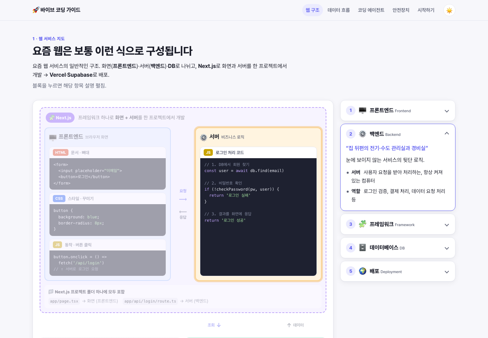

# 바이브 코딩 가이드

비개발자를 위한 웹 서비스 구조와 바이브 코딩 시작 가이드.

👉 **https://hyung-rae.github.io/coding-guide/**

1. **웹 서비스 지도** — 프론트엔드·백엔드·DB 구조도와 Next.js·Vercel·Supabase의 역할
2. **데이터 흐름** — 로그인 기능 7단계를 코드·데이터 이동으로 확인
3. **코딩 에이전트** — AI별 코딩 에이전트(Codex·Claude Code·Gemini CLI)와 대화창과의 차이, 기존 HTML을 이어서 개발하는 방법
4. **보안 안전장치** — API 키 관리, Git 저장점
5. **시작하기** — 계정·도구 준비부터 폴더·에이전트 실행, GitHub 연결, Vercel 배포까지 13단계 체크리스트

빌드 없이 `index.html`, `css/`, `js/`만으로 동작하는 정적 페이지. `index.html`을 브라우저로 열면 바로 확인 가능.
